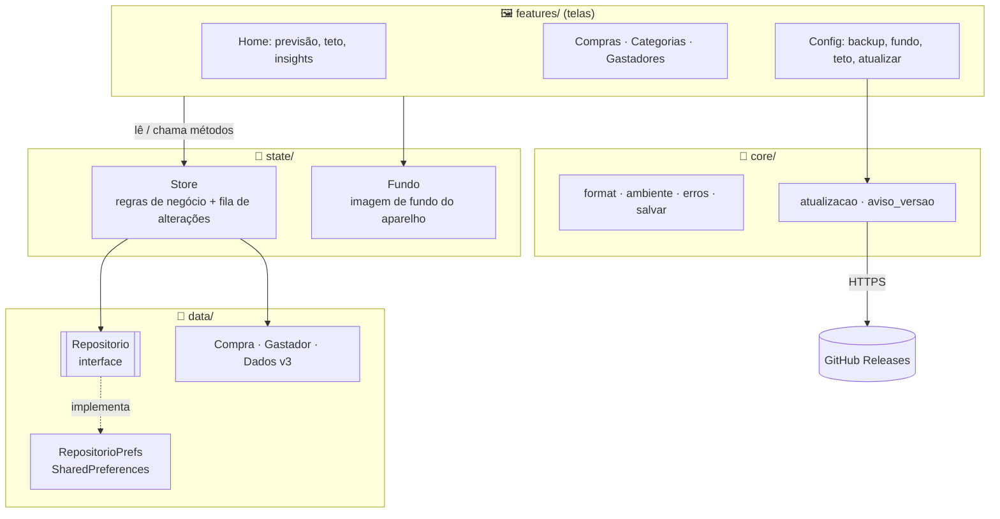
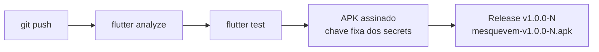

<div align="center">


# Mês que Vem 🇧🇷

**O app da família que prevê o rombo antes do rombo.**

*Porque "depois a gente vê" não é planejamento financeiro.*

[](https://flutter.dev)
[](https://dart.dev)
[](https://github.com/claulis/mesquevem/releases/latest)
[](https://m3.material.io)
[](https://pub.dev/packages/provider)
[](https://pub.dev/packages/shared_preferences)
[](https://github.com/claulis/mesquevem/actions)
[](https://github.com/claulis/mesquevem/releases/latest)
[](test)
[](#)

</div>

---

## 🎯 Objetivo

Toda família tem aquele momento: dia 20, conta zerada e alguém pergunta *"pra onde foi o dinheiro?"*. O **Mês que Vem** existe para trocar essa pergunta por outra, mais simpática: *"quanto vamos gastar no mês que vem?"*.

Você registra as compras do dia a dia e o app:

- 🔮 **prevê** quanto a família vai gastar no mês seguinte;
- 🚦 **avisa** quando uma categoria ou o mês inteiro está passando do combinado;
- 💡 **dá palpites** (insights) do tipo "no ritmo atual você fecha o mês em R$ 3.200".

Tudo **offline** e no próprio celular. Sem cadastro, sem nuvem, sem ninguém vendendo seus gastos com pizza para anunciante.

## ✨ Funcionalidades

| | Funcionalidade | O que faz |
|---|---|---|
| 🛒 | **Cadastro de compras** | Valor, data, descrição, categoria, evento e *gastador* |
| 🏷️ | **Categorias com limite** | Limite mensal por categoria. Na tela principal aparece em azul claro e fica 🟥 vermelho quando estoura |
| 🎉 | **Eventos** | Natal, aniversário, viagem… para saber quanto custou aquela festa "simples" |
| 👨‍👩‍👧 | **Gastadores** | O núcleo familiar (nome, aniversário, sexo). Cada compra pode ser de alguém ou de **Todos** |
| 🧢 | **Teto de gastos** | Quanto a família pode gastar no mês, com barra de progresso e a marca do ritmo ideal para hoje |
| 💡 | **Insights** | Ritmo do mês, quanto ainda pode gastar por dia, comparação com o mês passado, categorias perto do limite, aniversários chegando |
| 🔮 | **Previsão** | Três métodos estatísticos que se revezam conforme o histórico cresce (veja abaixo 👇) |
| 💾 | **Backup e compartilhamento** | Exporta e importa um JSON, ou manda direto pelo WhatsApp, e-mail ou Drive |
| 🖼️ | **Fundo personalizado** | *"Coloque uma imagem de quem, ou que, te inspira a gastar menos ou de quem, ou que, te faz gastar mais 😄"* |
| 🔄 | **Atualizar pelo app** | Config → Atualizar: confere a última versão no GitHub, baixa e abre o instalador. O download **continua de onde parou** se a internet cair, se você sair da tela ou até se fechar o app, e o SHA-256 é conferido antes de instalar |
| 🔔 | **Aviso de versão nova** | A cada ~12h o app dá uma espiada no GitHub e notifica se saiu versão nova |

## 🔮 Como a previsão funciona

Nada de bola de cristal: é estatística. Em [`lib/features/previsao/previsao.dart`](lib/features/previsao/previsao.dart), o app soma os gastos de cada mês fechado (mês sem compra conta como zero) e escolhe o método **pela quantidade de histórico**:

| Histórico | Método | Em português claro |
|---|---|---|
| sem mês fechado | **Total parcial** | "Ainda não te conheço, então chuto o que você já gastou este mês." |
| 1 a 5 meses | **Média móvel (3 meses)** | Média dos últimos 3 meses. Simples, honesta e difícil de errar feio. |
| 6 a 23 meses | **Suavização exponencial (α = 0,5)** | Média que dá mais peso aos meses recentes: `nível = 0,5 × mês + 0,5 × nível anterior`. Se a família mudou de hábito, ela percebe rápido. |
| 24+ meses | **Sazonal com crescimento anual** | Pega o mesmo mês do ano passado e corrige pela variação dos últimos 12 meses contra os 12 anteriores. Dezembro caro? Ela lembra. 🎄 |

> **Por que não usar uma IA gigante?** Porque para prever o gasto do supermercado uma média bem feita ganha de muito modelo chique, e roda num celular de 2015.

### 💡 Os insights da tela principal

Ficam em [`lib/features/previsao/insights.dart`](lib/features/previsao/insights.dart), uma função pura (sem Flutter), fácil de testar:

- **Ritmo**: `gasto até hoje ÷ dia do mês × dias do mês` → "No ritmo atual você fecha o mês em R$ X".
- **Quanto ainda pode gastar**: `(teto − gasto) ÷ dias restantes` → "Pode gastar R$ 45 por dia".
- **Mês passado**: compara com o **mesmo período** do mês anterior (dia 1 até o mesmo dia).
- **Perto do limite**: categoria entre 80% e 100% do limite.
- **Categoria que mais cresceu**: a que mais passou da média dos 3 meses anteriores.
- **Aniversários**: gastadores que fazem aniversário no mês que vem. Presente não brota do chão. 🎁
- **Previsão vs teto**: avisa se o mês que vem já nasce estourado.

## 🧰 Linguagem e plataformas

- **Linguagem:** [Dart 3](https://dart.dev), com records, pattern matching e `switch` expressions.
- **Framework:** [Flutter](https://flutter.dev) com Material 3.
- **Plataforma:** 🤖 **Android**, distribuído como APK assinado nas [Releases](https://github.com/claulis/mesquevem/releases).
- iOS, web e desktop: o Flutter até deixa, mas o orçamento do projeto também tem teto. 😅

## 🏛️ Arquitetura

Camadas simples, cada uma com uma responsabilidade. As telas **nunca** mexem nos dados diretamente: pedem ao `Store`.



Algumas decisões que fazem o app aguentar o tranco:

- **`Store` com fila**: carregar, salvar e exportar rodam **um de cada vez**, e cada alteração parte do estado deixado pela anterior. O app **só mostra o que foi gravado**: se o salvamento falha, a tela continua como estava e avisa.
- **Dados imutáveis**: `Compra` e `Gastador` não mudam no lugar. O `Store` troca o estado inteiro (`_d.copia()` → altera → salva → substitui).
- **Formato versionado (`versao: 3`)**: os dados e o backup usam o mesmo JSON. Versões antigas são migradas passo a passo (`Dados._migrar`). Um backup de versão mais nova é recusado com educação ("atualize o app"), sem ser corrompido.
- **Dados corrompidos?** O app guarda uma cópia antes de qualquer coisa e oferece "copiar dados" e "começar do zero". Ninguém perde as compras de 2 anos por causa de um byte torto.
- **`Repositorio` é uma interface**: trocar SharedPreferences por SQLite ou nuvem é escrever uma classe nova e mudar **uma linha** em `main.dart`.
- **Erros com nome e sobrenome**: `ErroDoApp` é o erro previsto, com mensagem para gente. O resto é defeito e vai para o `FlutterError.reportError`.
- **Fundo fora do backup**: a foto é do aparelho, não da família. Ninguém quer importar o backup e herdar a foto do cunhado.

### 📁 Estrutura

```
lib/
├── main.dart              # liga Providers, avisos de versão
├── app.dart               # MaterialApp, rotas, chaves globais
├── core/                  # utilidades sem regra de negócio
│   ├── format.dart        #   R$ 1.234,56, datas, meses, lerValor()
│   ├── atualizacao.dart   #   consulta a última release no GitHub
│   └── aviso_versao.dart  #   tarefa periódica + notificação
├── data/                  # modelos e persistência
│   ├── compra.dart · gastador.dart
│   ├── repositorio.dart   #   Dados (v3), migração, interface
│   └── repositorio_prefs.dart
├── state/                 # Store (regras) e Fundo
└── features/              # uma pasta por tela
    ├── previsao/          #   home, previsão, resumo, insights
    ├── compras/ · categorias/ · gastadores/
    ├── backup/ · config/  #   backup, fundo, teto, atualizar
    └── inicio/            #   carga inicial e tela de erro
test/                      # 111 testes (unidade + widget)
tool/make_icon.py          # gera o ícone (calendário nas cores do Brasil)
```

## 🚀 Pipeline de release

Todo push na branch principal vira uma versão nova, sem ninguém apertar botão:



- A **chave de assinatura** fica nos *secrets* do GitHub, nunca no código. É ela que deixa a versão nova **instalar por cima** sem perder os dados.
- O número `N` é o número do build. O app compara o `N` dele com o da última release para saber se precisa atualizar.

## 📲 Instalar e atualizar

1. Baixe o `mesquevem-v*.apk` da [**última release**](https://github.com/claulis/mesquevem/releases/latest).
2. Abra o arquivo no celular e permita "instalar apps desta fonte".
3. Para as próximas versões: **Config → Atualizar → Verificar atualização → Atualizar agora**. Ou toque na notificação quando ela aparecer. 🔔

> O Android sempre pede uma confirmação final antes de instalar. É segurança dele, não preguiça nossa.

## 🧪 Rodar e testar

```bash
flutter pub get
flutter test        # 111 testes, ~15 segundos
flutter run         # com um celular ou emulador Android conectado
```

Ícone novo? Edite e rode `python3 tool/make_icon.py`.

## 📜 Histórico de versões

| Versão | Novidades |
|---|---|
| v1.0.0-9 | Versão de teste da atualização pelo app 🔄 |
| v1.0.0-8 | Atualizar pelo app, aviso de versão nova, README novo |
| v1.0.0-7 | Barra do teto e insights na tela principal |
| v1.0.0-6 | Limites por categoria, gastadores, Config (backup, fundo, teto) |
| v1.0.0-5 | Nome "Mês que Vem" e ícone nas cores do Brasil |

## ❓ FAQ

**O app prevê se eu vou ganhar na Mega-Sena?**
Não. Ele só prevê que você vai gastar o dinheiro antes de ganhar.

**Por que "gastadores" e não "membros da família"?**
Porque é mais honesto.

**Meus dados vão para algum servidor?**
Não. Ficam no celular. O app só fala com a internet para perguntar ao GitHub se há versão nova.

**A previsão errou feio em dezembro!**
Com menos de 24 meses de histórico ela ainda não conhece o Natal da sua família. Dê tempo a ela. 🎅

**Posso usar o fundo para colocar a foto do meu chefe?**
Pode, se ele te inspira a gastar menos. Ou mais. Sem julgamentos.

---

<div align="center">

Feito no Brasil 🇧🇷 com Flutter, café e uma planilha que não aguentava mais.

</div>
