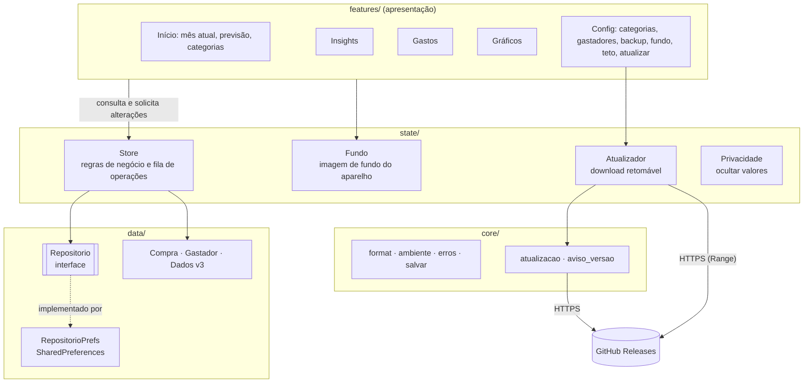

<div align="center">


# Mês que Vem

**O app da família que prevê o rombo antes do rombo.**

*Porque "depois a gente vê" não é planejamento financeiro.*

[](https://flutter.dev)
[](https://dart.dev)
[](https://github.com/claulis/mesquevem/releases/latest)
[](https://m3.material.io)
[](https://pub.dev/packages/provider)
[](https://pub.dev/packages/shared_preferences)
[](https://github.com/claulis/mesquevem/actions)
[](https://github.com/claulis/mesquevem/releases/latest)
[](test)
[](#)

</div>

---

## Objetivo

Toda família tem aquele momento: dia 20, conta zerada e alguém pergunta *"pra onde foi o dinheiro?"*. O **Mês que Vem** existe para trocar essa pergunta por outra, mais simpática: *"quanto vamos gastar no mês que vem?"*.

Você registra os gastos do dia a dia e o app:

- 🔮 **prevê** quanto a família vai gastar no mês seguinte;
- 🚦 **avisa** quando uma categoria ou o mês inteiro está passando do combinado;
- 💡 **dá palpites** (insights) do tipo "no ritmo atual você fecha o mês em R$ 3.200".

Tudo **offline** e no próprio celular. Sem cadastro, sem nuvem, sem ninguém vendendo seus gastos com pizza para anunciante.

## Funcionalidades

| | Funcionalidade | O que faz |
|---|---|---|
| 🏠 | **Tela principal** | Cartão do mês no topo: gasto até agora, teto, barra e quanto ainda dá para gastar por dia. Setas (ou deslizar o cartão) mostram os meses anteriores. A previsão fica num cartão menor, com o método no ⓘ |
| 🧭 | **Navegação** | Barra de baixo com **Início · Gastos · Config**, com a aba atual destacada. Categorias e Gastadores ficam dentro de Config |
| 🛒 | **Cadastro de gastos** | Valor, data, descrição, categoria, evento e *gastador*. O botão **+ Gasto** da tela principal abre o formulário direto |
| 👆 | **Gastos da categoria** | Tocar numa categoria ou num evento da tela principal lista os gastos que formam o valor: os do mês na tela ou de todos os meses, com o total. Dá para editar e excluir dali |
| 🏷️ | **Categorias com limite** | Limite mensal por categoria, com barra de progresso na tela principal: azul claro e, quando estoura, 🟥 vermelho com o aviso ⚠ "acima do limite". A lista vem da maior para a menor; as sem gasto ficam recolhidas |
| 🎉 | **Eventos** | Natal, aniversário, viagem… para saber quanto custou aquela festa "simples" |
| 👨‍👩‍👧 | **Gastadores** | O núcleo familiar (nome, aniversário, sexo). Cada gasto pode ser de alguém ou de **Todos** |
| 🧢 | **Teto de gastos** | Quanto a família pode gastar no mês, com barra de progresso e a marca do ritmo ideal para hoje |
| 💡 | **Insights** | Botão 💡 na tela principal com o número de insights no canto, como um contador de notificações. Abre a lista: ritmo do mês, quanto ainda pode gastar por dia, comparação com o mês passado, categorias perto do limite, aniversários chegando (alertas primeiro) |
| 👁️ | **Ocultar valores** | Botão do olho ao lado do 💡, como nos apps de banco: troca todos os valores por R$ ••••• para tirar print sem expor os gastos. A escolha continua ao reabrir o app |
| 📊 | **Gráficos** | Botão 📊 na tela principal, para o mês que estiver na tela: últimos 6 meses com o teto e a previsão, ritmo do mês (gasto acumulado contra o ritmo ideal ou o mês anterior), por gastador, categorias contra a média de 3 meses, mapa de calor dos dias, custo por evento (este ano e o anterior), composição por categoria e gasto por dia da semana. Tocar numa barra ou num dia mostra o valor |
| 🔮 | **Previsão** | Três métodos estatísticos que se revezam conforme o histórico cresce (veja a seção Previsão de gastos) |
| 💾 | **Backup e compartilhamento** | Exporta e importa um JSON, ou manda direto pelo WhatsApp, e-mail ou Drive |
| 🖼️ | **Fundo personalizado** | *"Coloque uma imagem de quem, ou que, te inspira a gastar menos ou de quem, ou que, te faz gastar mais 😄"*. A opacidade da imagem é ajustável de 5% a 100%, com prévia |
| 🌙 | **Tema escuro** | Segue o modo claro/escuro do celular |
| 👋 | **Primeiro uso** | Sem nenhum gasto, a tela principal mostra boas-vindas com os dois passos para começar: cadastrar o primeiro gasto e definir o teto |
| 🔄 | **Atualizar pelo app** | Config → Atualizar: confere a última versão no GitHub, baixa e abre o instalador. O download **continua de onde parou** se a internet cair, se você sair da tela ou até se fechar o app, e o SHA-256 é conferido antes de instalar |
| 🔔 | **Aviso de versão nova** | A cada ~12h o app dá uma espiada no GitHub e notifica se saiu versão nova |

## Previsão de gastos

### O que é previsto

O app soma o valor de todos os gastos de cada mês, formando o **histórico mensal** da família. Entram nesse histórico apenas os **meses fechados**, do primeiro mês com algum gasto até o mês passado, limitados aos últimos 36 meses (o método mais exigente usa 24). Um mês sem gastos nesse intervalo conta como R$ 0. O mês atual fica de fora, porque ainda está em andamento.

A partir desse histórico, o app estima quanto será gasto no **mês que vem**, ou seja, no mês seguinte ao atual. O cálculo está na função `previsao`, em [`lib/features/previsao/previsao.dart`](lib/features/previsao/previsao.dart), que não depende do Flutter e é coberta por testes.

### Escolha do método

O método é escolhido pela quantidade de meses fechados no histórico. O princípio é usar um método mais elaborado somente quando há dados suficientes para sustentá-lo: com pouco histórico, métodos complexos tendem a se ajustar a variações casuais e a errar mais.

| Meses de histórico | Método | Cálculo |
|---|---|---|
| nenhum | Total parcial | previsão = o que já foi gasto no mês atual |
| 1 a 5 | Média móvel | previsão = média dos últimos 3 meses (ou de todos, se houver menos de 3) |
| 6 a 23 | Suavização exponencial | a cada mês: `nível = 0,5 × gasto do mês + 0,5 × nível anterior`; previsão = último nível |
| 24 ou mais | Sazonal com crescimento | previsão = gasto do mesmo mês no ano passado × crescimento anual |

**Média móvel.** Usa a média dos meses mais recentes como estimativa do gasto típico da família. É simples e estável, adequada quando há poucos meses de dados.

**Suavização exponencial.** Também é uma média, mas dá mais peso aos meses recentes: o último mês vale 50%, o anterior 25%, o anterior a ele 12,5%, e assim por diante. Com isso, a previsão acompanha mais rápido uma mudança de hábito. O peso de 0,5 é fixo.

**Sazonal com crescimento.** Aproveita o fato de que certos meses se repetem todo ano (dezembro costuma ser mais caro, por exemplo). Parte do gasto do mesmo mês no ano anterior e o corrige pelo crescimento anual:

```
crescimento = (soma dos últimos 12 meses) ÷ (soma dos 12 meses anteriores a eles)
```

Se a soma dos 12 meses anteriores for zero, o crescimento é 1, isto é, sem correção. São necessários 24 meses de histórico (dois anos completos) para calcular esse crescimento.

**Exemplo.** Hoje é outubro de 2026 e a família gastou R$ 100 por mês de outubro/2024 a setembro/2025 e R$ 200 por mês de outubro/2025 a setembro/2026. Há 24 meses de histórico, então o método é o sazonal. O mês que vem é novembro; em novembro/2025 o gasto foi R$ 200. O crescimento é 2.400 ÷ 1.200 = 2. A previsão para novembro/2026 é R$ 200 × 2 = **R$ 400**. Este caso é um dos testes automatizados do projeto.

### Limitações

- Os métodos são propositalmente simples. Eles não informam uma margem de erro, e o peso de 0,5 e os limites de 6 e 24 meses foram fixados, não calibrados com dados reais.
- A suavização exponencial não capta tendência de alta ou de queda dentro do ano, e o método sazonal supõe que o padrão anual se repete. A evolução natural, ainda não implementada, é o método de Holt-Winters, que trata nível, tendência e sazonalidade juntos.
- Gastos fora do comum (uma viagem, um conserto) entram integralmente na média e puxam a previsão para cima nos meses seguintes.

Referência: R. J. Hyndman e G. Athanasopoulos, *Forecasting: Principles and Practice*, 3.ª ed., OTexts, 2021 ([otexts.com/fpp3](https://otexts.com/fpp3/)).

### Indicadores (insights)

Aparecem na tela **Insights**, aberta pelo botão 💡 da tela principal, que mostra quantos há. Calculados em [`lib/features/previsao/insights.dart`](lib/features/previsao/insights.dart). Cada indicador só aparece quando se aplica; os que dependem do teto, por exemplo, só aparecem com o teto cadastrado.

| Indicador | Como é calculado |
|---|---|
| Ritmo do mês | `gasto até hoje ÷ dia de hoje × dias do mês`. Supõe que o gasto continue no mesmo ritmo até o fim do mês |
| Quanto ainda pode gastar por dia | `(teto − gasto até hoje) ÷ dias que faltam`, contando hoje. Se o teto já foi ultrapassado, mostra o valor excedido |
| Comparação com o mês passado | Compara o gasto de hoje com o do mês passado **no mesmo período** (do dia 1 até o mesmo dia), em percentual |
| Limite da categoria | Avisa quando uma categoria já usou entre 80% e 100% do limite e quando passou dele ("passou do limite em R$ X"); na lista, a categoria estourada aparece em vermelho |
| Categoria que mais cresceu | Compara o gasto de cada categoria neste mês com a média dela nos 3 meses anteriores e mostra a que mais ultrapassou essa média |
| Previsão acima do teto | Avisa quando a previsão do mês que vem já é maior que o teto |
| Aniversários | Lista os gastadores que fazem aniversário no mês que vem |

A comparação por categoria confronta um mês **ainda em andamento** com meses **completos**. O alerta é, portanto, cauteloso: só aparece quando o gasto parcial já supera a média de um mês inteiro.

## Linguagem e plataformas

- **Linguagem:** [Dart 3](https://dart.dev), com records, pattern matching e `switch` expressions.
- **Framework:** [Flutter](https://flutter.dev) com Material 3.
- **Plataforma:** 🤖 **Android**, distribuído como APK assinado nas [Releases](https://github.com/claulis/mesquevem/releases).
- iOS, web e desktop: o Flutter até deixa, mas o orçamento do projeto também tem teto. 😅

## Arquitetura

### Visão geral

O aplicativo adota uma **arquitetura em camadas com fluxo de dados unidirecional**: a interface lê o estado e solicita alterações ao `Store`, que as valida, persiste por meio de uma abstração de repositório e só então publica o novo estado. Os padrões empregados são:

- **Observer**: `ChangeNotifier` e `Provider` notificam a interface a cada mudança de estado.
- **Repository**: o `Store` depende da interface `Repositorio`, não de uma implementação de armazenamento (inversão de dependência).
- **Fonte única da verdade**: os dados de domínio residem somente no `Store`; as telas não os alteram diretamente.

| Camada | Diretório | Responsabilidade |
|---|---|---|
| Apresentação | `features/` | Widgets; leitura do estado via `context.watch` e solicitação de alterações ao `Store` |
| Estado e regras de negócio | `state/` | `Store` (dados de domínio e regras), `Fundo` (imagem de fundo, preferência do aparelho) e `Atualizador` (máquina de estados da atualização do aplicativo) |
| Dados | `data/` | Modelos imutáveis (`Compra`, `Gastador`), agregado `Dados`, interface `Repositorio` e a implementação `RepositorioPrefs` |
| Núcleo | `core/` | Formatação, tratamento de erros, acesso ao ambiente, consulta de versão e agendamento da verificação periódica |



### Propriedades de projeto

1. **Serialização das operações.** Carga, exportação e alterações são encadeadas em uma fila de `Future`s (`Store._naFila`) e executam estritamente em sequência, cada uma partindo do estado produzido pela anterior. Isso fornece exclusão mútua lógica, sem travas, sobre o modelo de eventos de thread única do Dart e elimina condições de corrida entre operações assíncronas.
2. **Persistir antes de publicar.** Cada alteração é aplicada a uma cópia do estado, gravada no repositório e somente depois substitui o estado em memória e notifica os observadores (`Store._trocar`). Se a gravação falha, o estado e a interface permanecem inalterados, de modo que a interface nunca exibe dados que não foram persistidos.
3. **Imutabilidade.** Os modelos são imutáveis. O novo estado é uma cópia rasa (listas novas com elementos compartilhados), o que evita que objetos já entregues à interface sejam modificados posteriormente.
4. **Serialização versionada e migração incremental.** O armazenamento interno e o arquivo de backup usam o mesmo JSON, com o campo `versao` (atual: 3). `Dados._migrar` aplica as transformações passo a passo, da versão lida até a atual, e campos novos são opcionais com valores padrão, o que garante compatibilidade retroativa. Dados de versão superior à suportada são rejeitados sem alteração (falha segura).
5. **Validação na fronteira de confiança.** Backups e dados lidos do disco são validados na entrada: valores não finitos, limites e teto inválidos são rejeitados; identificadores duplicados são resolvidos de forma determinística; e limites de categorias inexistentes são descartados antes de chegarem ao domínio.
6. **Recuperação de dados ilegíveis.** Quando a leitura falha, o conteúdo bruto é preservado em uma cópia antes de qualquer descarte, e o usuário pode copiá-lo ou recomeçar com confirmação explícita.
7. **Taxonomia de erros.** `ErroDoApp` representa falhas previstas, com mensagem destinada ao usuário. Qualquer outra exceção é tratada como defeito e encaminhada a `FlutterError.reportError`, sem ser mascarada como falha comum.
8. **Persistência substituível.** Trocar `SharedPreferences` por SQLite ou por um serviço remoto exige uma nova implementação de `Repositorio` e a alteração de uma única linha em `main.dart`.
9. **Isolamento de dados do dispositivo.** A imagem de fundo é um arquivo local, fora do modelo de domínio e do backup.

### Atualização do aplicativo

- **Detecção.** Consulta HTTP à API de releases do GitHub. O número de build é embutido na compilação (`--dart-define`) e comparado ao da última release; compilações de desenvolvimento nunca oferecem atualização.
- **Transferência retomável.** O `Atualizador` mantém em disco o arquivo parcial e seus metadados (tamanho total e `ETag`). Após uma falha de rede, retoma com `Range: bytes=N-` condicionado por `If-Range` (RFC 9110): o servidor só continua se o recurso for o mesmo; caso contrário, a transferência recomeça do início. As tentativas seguem espera crescente (backoff), e um download interrompido é retomado na próxima abertura do aplicativo.
- **Integridade.** O tamanho e o SHA-256 do arquivo são conferidos contra o resumo informado pela API antes da instalação.
- **Autenticidade.** O APK é assinado com uma chave fixa, mantida fora do repositório, o que permite ao Android reconhecer a atualização como sucessora do pacote instalado e preservar os dados.
- **Aviso de nova versão.** Tarefa periódica (WorkManager, cerca de 12 h, condicionada à rede) que emite uma notificação local uma única vez por versão.

### Estrutura

```
lib/
├── main.dart              # liga Providers, avisos de versão
├── app.dart               # MaterialApp, rotas, chaves globais
├── core/                  # utilidades sem regra de negócio
│   ├── format.dart        #   R$ 1.234,56, datas, meses, lerValor()
│   ├── atualizacao.dart   #   consulta a última release no GitHub
│   └── aviso_versao.dart  #   tarefa periódica + notificação
├── data/                  # modelos e persistência
│   ├── compra.dart · gastador.dart
│   ├── repositorio.dart   #   Dados (v3), migração, interface
│   └── repositorio_prefs.dart
├── state/                 # Store (regras), Fundo, Privacidade e Atualizador
└── features/              # uma pasta por tela
    ├── previsao/          #   home, previsão, resumo, insights (regras e tela)
    ├── compras/ · categorias/ · gastadores/
    ├── graficos/          #   dados dos 8 gráficos (puros) e a tela
    ├── backup/ · config/  #   backup, fundo, teto, atualizar
    └── inicio/            #   carga inicial, tela de erro e abas
test/                      # 162 testes (unidade e widget)
tool/make_icon.py          # gera o ícone (calendário nas cores do Brasil)
```

## Instalar e atualizar

1. Baixe o `mesquevem-v*.apk` da [**última release**](https://github.com/claulis/mesquevem/releases/latest).
2. Abra o arquivo no celular e permita "instalar apps desta fonte".
3. Para as próximas versões: **Config → Atualizar → Verificar atualização → Atualizar agora**. Ou toque na notificação quando ela aparecer. 🔔

> O Android sempre pede uma confirmação final antes de instalar. É segurança dele, não preguiça nossa.

## Rodar e testar

```bash
flutter pub get
flutter test        # 162 testes
flutter run         # com um celular ou emulador Android conectado
```

Ícone novo? Edite e rode `python3 tool/make_icon.py`.

## FAQ

**O app prevê se eu vou ganhar na Mega-Sena?**
Não. Ele só prevê que você vai gastar o dinheiro antes de ganhar.

**Por que "gastadores" e não "membros da família"?**
Porque é mais honesto.

**Meus dados vão para algum servidor?**
Não. Ficam no celular. O app só fala com a internet para perguntar ao GitHub se há versão nova.

**A previsão errou feio em dezembro!**
Com menos de 24 meses de histórico ela ainda não conhece o Natal da sua família. Dê tempo a ela. 🎅

**Posso usar o fundo para colocar a foto do meu chefe?**
Pode, se ele te inspira a gastar menos. Ou mais. Sem julgamentos.

---

<div align="center">

Feito no Brasil 🇧🇷 com Flutter, café e uma planilha que não aguentava mais.

</div>
