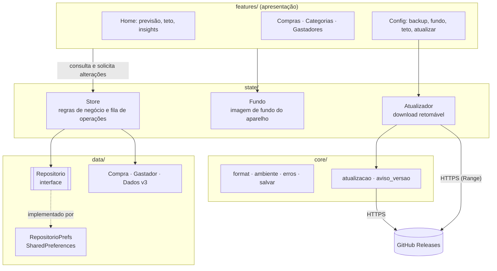

<div align="center">


# Mês que Vem

**O app da família que prevê o rombo antes do rombo.**

*Porque "depois a gente vê" não é planejamento financeiro.*

[](https://flutter.dev)
[](https://dart.dev)
[](https://github.com/claulis/mesquevem/releases/latest)
[](https://m3.material.io)
[](https://pub.dev/packages/provider)
[](https://pub.dev/packages/shared_preferences)
[](https://github.com/claulis/mesquevem/actions)
[](https://github.com/claulis/mesquevem/releases/latest)
[](test)
[](#)

</div>

---

## Objetivo

Toda família tem aquele momento: dia 20, conta zerada e alguém pergunta *"pra onde foi o dinheiro?"*. O **Mês que Vem** existe para trocar essa pergunta por outra, mais simpática: *"quanto vamos gastar no mês que vem?"*.

Você registra as compras do dia a dia e o app:

- 🔮 **prevê** quanto a família vai gastar no mês seguinte;
- 🚦 **avisa** quando uma categoria ou o mês inteiro está passando do combinado;
- 💡 **dá palpites** (insights) do tipo "no ritmo atual você fecha o mês em R$ 3.200".

Tudo **offline** e no próprio celular. Sem cadastro, sem nuvem, sem ninguém vendendo seus gastos com pizza para anunciante.

## Funcionalidades

| | Funcionalidade | O que faz |
|---|---|---|
| 🛒 | **Cadastro de compras** | Valor, data, descrição, categoria, evento e *gastador* |
| 🏷️ | **Categorias com limite** | Limite mensal por categoria. Na tela principal aparece em azul claro e fica 🟥 vermelho quando estoura |
| 🎉 | **Eventos** | Natal, aniversário, viagem… para saber quanto custou aquela festa "simples" |
| 👨‍👩‍👧 | **Gastadores** | O núcleo familiar (nome, aniversário, sexo). Cada compra pode ser de alguém ou de **Todos** |
| 🧢 | **Teto de gastos** | Quanto a família pode gastar no mês, com barra de progresso e a marca do ritmo ideal para hoje |
| 💡 | **Insights** | Ritmo do mês, quanto ainda pode gastar por dia, comparação com o mês passado, categorias perto do limite, aniversários chegando |
| 🔮 | **Previsão** | Três métodos estatísticos que se revezam conforme o histórico cresce (veja a seção Previsão de gastos) |
| 💾 | **Backup e compartilhamento** | Exporta e importa um JSON, ou manda direto pelo WhatsApp, e-mail ou Drive |
| 🖼️ | **Fundo personalizado** | *"Coloque uma imagem de quem, ou que, te inspira a gastar menos ou de quem, ou que, te faz gastar mais 😄"* |
| 🔄 | **Atualizar pelo app** | Config → Atualizar: confere a última versão no GitHub, baixa e abre o instalador. O download **continua de onde parou** se a internet cair, se você sair da tela ou até se fechar o app, e o SHA-256 é conferido antes de instalar |
| 🔔 | **Aviso de versão nova** | A cada ~12h o app dá uma espiada no GitHub e notifica se saiu versão nova |

## Previsão de gastos

### Formulação do problema

Seja $y_t$ o total gasto no mês $t$ (soma dos valores das compras com data naquele mês), para $t = 1, \dots, n$, em que $t = 1$ é o primeiro mês com ao menos uma compra e $t = n$ é o último mês **fechado**, isto é, o mês anterior ao corrente. Meses sem compras dentro desse intervalo assumem $y_t = 0$. O mês corrente, por estar incompleto, não integra a série.

O objetivo é estimar $\hat{y}$, o gasto total do mês **seguinte ao corrente**, o que corresponde ao horizonte $h = 2$ em relação à última observação da série. A implementação é a função pura `previsao`, em [`lib/features/previsao/previsao.dart`](lib/features/previsao/previsao.dart), sem dependência do Flutter e coberta por testes unitários.

### Seleção do estimador

O estimador é escolhido pelo comprimento $n$ da série. O critério é a parcimônia: um modelo só é empregado quando há observações suficientes para sustentá-lo, o que evita o sobreajuste de modelos com mais estrutura a séries curtas.

| Condição | Estimador | Expressão |
|---|---|---|
| $n = 0$ | Total parcial | $\hat{y}$ = gasto acumulado no mês corrente |
| $1 \le n \le 5$ | Média móvel simples de ordem $k = \min(3,\, n)$ | $\hat{y} = \dfrac{1}{k} \displaystyle\sum_{i=n-k+1}^{n} y_i$ |
| $6 \le n \le 23$ | Suavização exponencial simples, $\alpha = 0{,}5$ | $\ell_1 = y_1$; $\ell_t = \alpha\, y_t + (1-\alpha)\, \ell_{t-1}$; $\hat{y} = \ell_n$ |
| $n \ge 24$ | Sazonal ingênuo com fator de crescimento anual | $\hat{y} = y_{n-10} \cdot g$, com $g = \dfrac{\sum_{i=n-11}^{n} y_i}{\sum_{i=n-23}^{n-12} y_i}$ |

**Média móvel simples.** Estima o nível da série pela média das $k$ observações mais recentes. A previsão é constante em relação ao horizonte. Com $n < 3$, utilizam-se todas as observações disponíveis.

**Suavização exponencial simples.** Equivale a uma média ponderada com pesos que decaem geometricamente: a observação mais recente recebe peso $\alpha = 0{,}5$, a anterior $0{,}25$, a seguinte $0{,}125$, e assim por diante. Adapta-se a mudanças de patamar mais rapidamente que a média móvel. O parâmetro $\alpha$ é fixo e não estimado a partir dos dados.

**Sazonal ingênuo com crescimento.** O mês-alvo é o $(n+2)$-ésimo da série, e sua referência sazonal é a observação do mesmo mês do calendário no ano anterior, $y_{(n+2)-12} = y_{n-10}$. Essa referência é multiplicada pelo fator $g$, a razão entre a soma dos últimos 12 meses e a dos 12 meses precedentes, que estima a variação anual do nível de gastos. Se o denominador for nulo, adota-se $g = 1$. São necessárias 24 observações, isto é, dois ciclos sazonais completos, para que $g$ possa ser calculado.

### Limitações

- Os estimadores são heurísticas de baixa complexidade. Não há estimação do parâmetro $\alpha$ nem intervalos de predição, e a seleção do método por limiares fixos não foi validada por validação cruzada em séries temporais (origem móvel).
- A suavização exponencial simples não modela tendência, e o método sazonal assume padrão anual estável. A extensão natural, ainda não implementada, é o método de Holt-Winters.
- Compras extraordinárias (por exemplo, uma viagem) afetam diretamente as estimativas de nível, pois a série não é filtrada de valores atípicos.

Referência: R. J. Hyndman e G. Athanasopoulos, *Forecasting: Principles and Practice*, 3.ª ed., OTexts, 2021 ([otexts.com/fpp3](https://otexts.com/fpp3/)).

### Indicadores derivados

Calculados por funções puras em [`lib/features/previsao/insights.dart`](lib/features/previsao/insights.dart). Sejam $d$ o dia corrente, $D$ o número de dias do mês, $G$ o gasto acumulado no mês e $T$ o teto de gastos, quando cadastrado.

| Indicador | Definição |
|---|---|
| Projeção do mês | $\hat{G}_{\text{fim}} = G \cdot D / d$, extrapolação proporcional que supõe gasto uniformemente distribuído nos dias |
| Orçamento diário restante | $(T - G) / (D - d + 1)$, incluindo o dia corrente; se $G > T$, exibe-se o excedente $G - T$ |
| Variação em relação ao mês anterior | $\Delta = G / G^{\text{ant}}_{[1,\, d']} - 1$, com $d' = \min(d,\, D_{\text{ant}})$, de modo que os dois períodos tenham o mesmo número de dias |
| Utilização do limite de uma categoria | $u = G_c / L_c$; alerta para $0{,}8 \le u \le 1$, e acima de $1$ a categoria é exibida em vermelho |
| Categoria com maior desvio | Para cada categoria $c$, $\bar{G}_c = \frac{1}{3} \sum_{j=1}^{3} G_c^{(-j)}$ (média dos três meses fechados anteriores); seleciona-se a de maior $G_c - \bar{G}_c > 0$ com $\bar{G}_c > 0$ |
| Previsão acima do teto | $\hat{y} > T$ |
| Aniversários | Gastadores cujo mês de aniversário é o mês seguinte ao corrente |

O desvio por categoria compara o acumulado **parcial** do mês corrente com médias de meses **completos**. O alerta é, portanto, conservador: só dispara quando o acumulado parcial já supera a média.

## Linguagem e plataformas

- **Linguagem:** [Dart 3](https://dart.dev), com records, pattern matching e `switch` expressions.
- **Framework:** [Flutter](https://flutter.dev) com Material 3.
- **Plataforma:** 🤖 **Android**, distribuído como APK assinado nas [Releases](https://github.com/claulis/mesquevem/releases).
- iOS, web e desktop: o Flutter até deixa, mas o orçamento do projeto também tem teto. 😅

## Arquitetura

### Visão geral

O aplicativo adota uma **arquitetura em camadas com fluxo de dados unidirecional**: a interface lê o estado e solicita alterações ao `Store`, que as valida, persiste por meio de uma abstração de repositório e só então publica o novo estado. Os padrões empregados são:

- **Observer**: `ChangeNotifier` e `Provider` notificam a interface a cada mudança de estado.
- **Repository**: o `Store` depende da interface `Repositorio`, não de uma implementação de armazenamento (inversão de dependência).
- **Fonte única da verdade**: os dados de domínio residem somente no `Store`; as telas não os alteram diretamente.

| Camada | Diretório | Responsabilidade |
|---|---|---|
| Apresentação | `features/` | Widgets; leitura do estado via `context.watch` e solicitação de alterações ao `Store` |
| Estado e regras de negócio | `state/` | `Store` (dados de domínio e regras), `Fundo` (imagem de fundo, preferência do aparelho) e `Atualizador` (máquina de estados da atualização do aplicativo) |
| Dados | `data/` | Modelos imutáveis (`Compra`, `Gastador`), agregado `Dados`, interface `Repositorio` e a implementação `RepositorioPrefs` |
| Núcleo | `core/` | Formatação, tratamento de erros, acesso ao ambiente, consulta de versão e agendamento da verificação periódica |



### Propriedades de projeto

1. **Serialização das operações.** Carga, exportação e alterações são encadeadas em uma fila de `Future`s (`Store._naFila`) e executam estritamente em sequência, cada uma partindo do estado produzido pela anterior. Isso fornece exclusão mútua lógica, sem travas, sobre o modelo de eventos de thread única do Dart e elimina condições de corrida entre operações assíncronas.
2. **Persistir antes de publicar.** Cada alteração é aplicada a uma cópia do estado, gravada no repositório e somente depois substitui o estado em memória e notifica os observadores (`Store._trocar`). Se a gravação falha, o estado e a interface permanecem inalterados, de modo que a interface nunca exibe dados que não foram persistidos.
3. **Imutabilidade.** Os modelos são imutáveis. O novo estado é uma cópia rasa (listas novas com elementos compartilhados), o que evita que objetos já entregues à interface sejam modificados posteriormente.
4. **Serialização versionada e migração incremental.** O armazenamento interno e o arquivo de backup usam o mesmo JSON, com o campo `versao` (atual: 3). `Dados._migrar` aplica as transformações passo a passo, da versão lida até a atual, e campos novos são opcionais com valores padrão, o que garante compatibilidade retroativa. Dados de versão superior à suportada são rejeitados sem alteração (falha segura).
5. **Validação na fronteira de confiança.** Backups e dados lidos do disco são validados na entrada: valores não finitos, limites e teto inválidos são rejeitados; identificadores duplicados são resolvidos de forma determinística; e limites de categorias inexistentes são descartados antes de chegarem ao domínio.
6. **Recuperação de dados ilegíveis.** Quando a leitura falha, o conteúdo bruto é preservado em uma cópia antes de qualquer descarte, e o usuário pode copiá-lo ou recomeçar com confirmação explícita.
7. **Taxonomia de erros.** `ErroDoApp` representa falhas previstas, com mensagem destinada ao usuário. Qualquer outra exceção é tratada como defeito e encaminhada a `FlutterError.reportError`, sem ser mascarada como falha comum.
8. **Persistência substituível.** Trocar `SharedPreferences` por SQLite ou por um serviço remoto exige uma nova implementação de `Repositorio` e a alteração de uma única linha em `main.dart`.
9. **Isolamento de dados do dispositivo.** A imagem de fundo é um arquivo local, fora do modelo de domínio e do backup.

### Atualização do aplicativo

- **Detecção.** Consulta HTTP à API de releases do GitHub. O número de build é embutido na compilação (`--dart-define`) e comparado ao da última release; compilações de desenvolvimento nunca oferecem atualização.
- **Transferência retomável.** O `Atualizador` mantém em disco o arquivo parcial e seus metadados (tamanho total e `ETag`). Após uma falha de rede, retoma com `Range: bytes=N-` condicionado por `If-Range` (RFC 9110): o servidor só continua se o recurso for o mesmo; caso contrário, a transferência recomeça do início. As tentativas seguem espera crescente (backoff), e um download interrompido é retomado na próxima abertura do aplicativo.
- **Integridade.** O tamanho e o SHA-256 do arquivo são conferidos contra o resumo informado pela API antes da instalação.
- **Autenticidade.** O APK é assinado com uma chave fixa, mantida fora do repositório, o que permite ao Android reconhecer a atualização como sucessora do pacote instalado e preservar os dados.
- **Aviso de nova versão.** Tarefa periódica (WorkManager, cerca de 12 h, condicionada à rede) que emite uma notificação local uma única vez por versão.

### Estrutura

```
lib/
├── main.dart              # liga Providers, avisos de versão
├── app.dart               # MaterialApp, rotas, chaves globais
├── core/                  # utilidades sem regra de negócio
│   ├── format.dart        #   R$ 1.234,56, datas, meses, lerValor()
│   ├── atualizacao.dart   #   consulta a última release no GitHub
│   └── aviso_versao.dart  #   tarefa periódica + notificação
├── data/                  # modelos e persistência
│   ├── compra.dart · gastador.dart
│   ├── repositorio.dart   #   Dados (v3), migração, interface
│   └── repositorio_prefs.dart
├── state/                 # Store (regras), Fundo e Atualizador
└── features/              # uma pasta por tela
    ├── previsao/          #   home, previsão, resumo, insights
    ├── compras/ · categorias/ · gastadores/
    ├── backup/ · config/  #   backup, fundo, teto, atualizar
    └── inicio/            #   carga inicial e tela de erro
test/                      # 120 testes (unidade e widget)
tool/make_icon.py          # gera o ícone (calendário nas cores do Brasil)
```

## Instalar e atualizar

1. Baixe o `mesquevem-v*.apk` da [**última release**](https://github.com/claulis/mesquevem/releases/latest).
2. Abra o arquivo no celular e permita "instalar apps desta fonte".
3. Para as próximas versões: **Config → Atualizar → Verificar atualização → Atualizar agora**. Ou toque na notificação quando ela aparecer. 🔔

> O Android sempre pede uma confirmação final antes de instalar. É segurança dele, não preguiça nossa.

## Rodar e testar

```bash
flutter pub get
flutter test        # 120 testes
flutter run         # com um celular ou emulador Android conectado
```

Ícone novo? Edite e rode `python3 tool/make_icon.py`.

## FAQ

**O app prevê se eu vou ganhar na Mega-Sena?**
Não. Ele só prevê que você vai gastar o dinheiro antes de ganhar.

**Por que "gastadores" e não "membros da família"?**
Porque é mais honesto.

**Meus dados vão para algum servidor?**
Não. Ficam no celular. O app só fala com a internet para perguntar ao GitHub se há versão nova.

**A previsão errou feio em dezembro!**
Com menos de 24 meses de histórico ela ainda não conhece o Natal da sua família. Dê tempo a ela. 🎅

**Posso usar o fundo para colocar a foto do meu chefe?**
Pode, se ele te inspira a gastar menos. Ou mais. Sem julgamentos.

---

<div align="center">

Feito no Brasil 🇧🇷 com Flutter, café e uma planilha que não aguentava mais.

</div>
